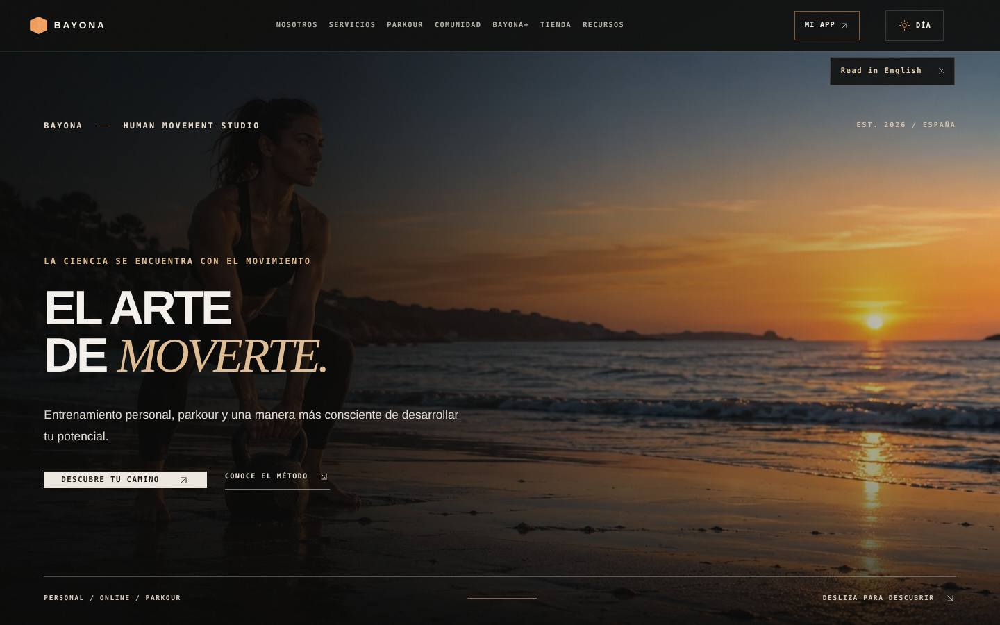
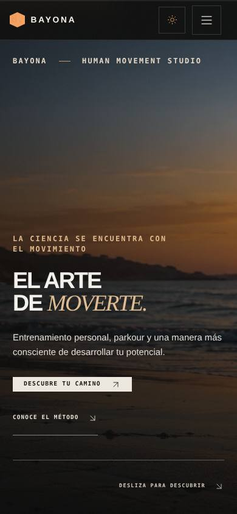

# BAYONA Luxury Studio — 3 de noviembre de 2026

## Resumen
Rediseño editorial de la portada pública de BAYONA, creado sobre el commit verificado `a7da1d2` en una rama y directorio separados de los trabajos activos.

- **Rama:** `feature/luxury-studio-20261103`
- **Directorio:** `/home/sebastian/BAYONA/01_WEB/BAYONA-LUXURY-STUDIO-20261103`
- **Ruta rediseñada:** `/` (inicio)
- **Rutas preservadas:** `/about`, `/programs`, `/parkour-academy`, `/app`, `/community`, `/resources`, `/shop`, `/faq` y resto del sitio.
- **Vista local:** `http://127.0.0.1:4292/`, solo accesible desde el equipo en el que se ejecuta el servidor. No es un enlace público.

## Dirección de arte
- Negro carbón profundo, marfil cálido y acento bronce moderado.
- Tipografía sans editorial contrastada con cursiva serif.
- Hero panorámico de alto contraste, jerarquía directa, espacios amplios y llamadas a la acción reales.
- Tres tarjetas visuales sobre entrenamiento personal, parkour y movilidad.
- Filosofía, método, archivo real de ocho vídeos, presentación de BAYONA+ y tres recursos descargables.
- Contacto a través del enlace real configurado en `src/config/site.config.js`.

## Material audiovisual y seguridad de marca
Las fotografías de entrenamiento que ilustran esta portada proceden de `public/images/bayona-generated/` y son **imágenes conceptuales**; no se presentan como fotografías de Sebastián. La web incorpora el archivo audiovisual del proyecto anterior con ocho clips procedentes de carpetas de revisión final. **No se atribuyen rostros no confirmados ni se utilizan testimonios, métricas de alumnos o números de WhatsApp inventados.**

Antes del despliegue público, comprobar derechos de imagen, consentimientos de terceros y autorización final de los vídeos. Las fotografías originales cuya identidad quedó cuestionada en `3e10669` no se han vuelto a publicar.

## Comportamiento y rendimiento
- El inicio no monta el HUD de misión, ni los toasts de capítulos, ni las capas ambientales invasivas; estas funciones permanecen en el resto de rutas.
- Las tarjetas enlazan a rutas reales y los PDFs se descargan desde sus destinos existentes.
- El archivo de ocho clips conserva reproducción bajo demanda, sin descarga automática de todos los vídeos.
- El hero respeta `prefers-reduced-motion`.
- La página ha pasado comprobaciones a 360, 390, 768 y 1440 px sin desbordamiento horizontal.

## Verificación (3 nov 2026)
- **7/7 tests Playwright superados** en `e2e/bayona-atelier-luxury.spec.js`.
- **Build Vite aprobado** (22,26 s).
- **Lint:** 0 errores y 6 avisos del analizador por referencias JSX (la configuración actual no marca esos imports como usados).
- Se mantiene la advertencia existente del chunk `vendor-three` de 909 KB. Es un objetivo posterior de optimización.
- **No se ha publicado en producción.** La rama no sustituye el borrador no confirmado de Home-redesign situado en el árbol de trabajo principal.

## Capturas de QA

## Ficheros principales
- `src/pages/HomeAtelier.jsx`: estructura.
- `src/pages/home-atelier.css`: sistema visual y responsive.
- `src/App.jsx`: entrada del inicio y aislamiento de capas intrusivas.
- `e2e/bayona-atelier-luxury.spec.js`: pruebas.

## Siguientes iteraciones
1. Validar una foto original del rostro de Sebastián y reemplazar los retratos conceptuales solo si corresponden a su identidad.
2. Hacer una revisión de consistencia visual de `/about`, `/programs`, `/parkour-academy` y demás interiores para que respondan al mismo lenguaje editorial.
3. Revisar contenido visual y permisos antes de publicar.
4. Optimizar módulos de Three.js y verificar métricas de campo (LCP, INP y CLS) en un despliegue de prueba.
