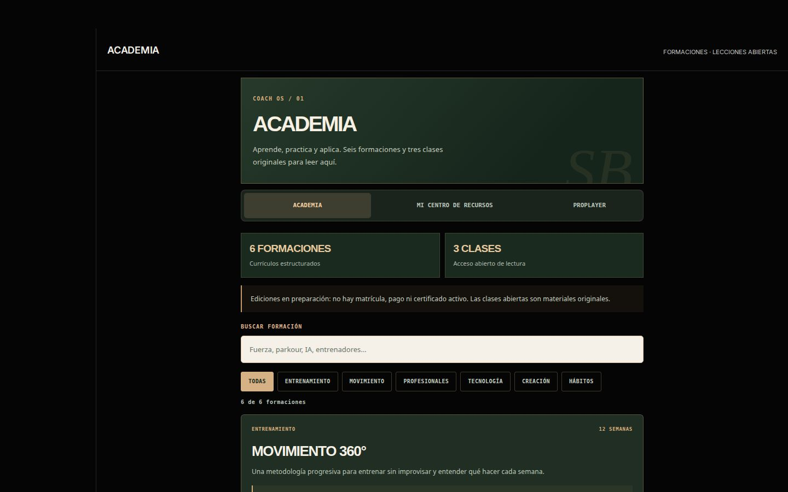
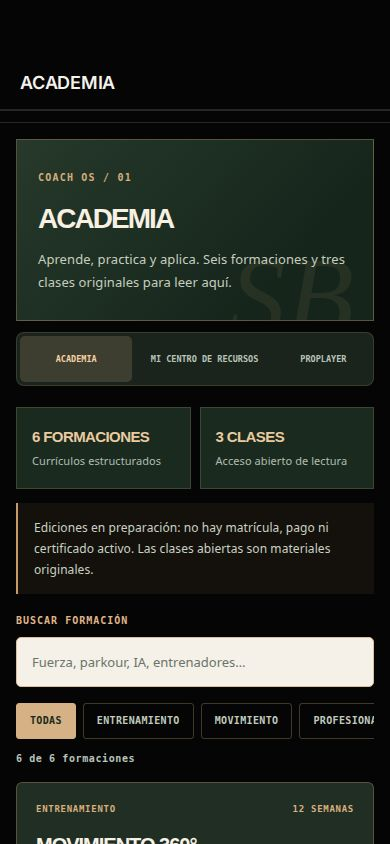
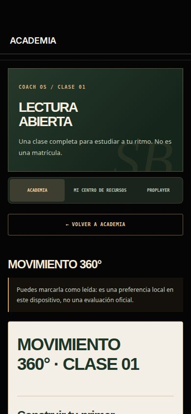
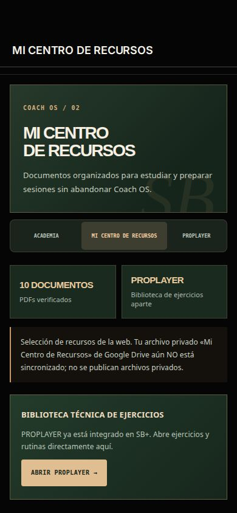

# COACH OS — Academia y Mi Centro de Recursos
**SEBASTIAN BAYONA · Implementación 6 de noviembre de 2026**

## Resumen ejecutivo

Se incorporan dos módulos reales dentro de la aplicación SB+, accesibles desde el panel Coach OS. El entrenador no tiene que abandonar la aplicación para consultar los temarios, leer las clases gratuitas, buscar documentos y guardar favoritos. Se conserva la biblioteca técnica PROPLAYER.

| Módulo | Entrega | Estado |
|---|---|---|
| Academia | Seis formaciones con temarios; tres primeras clases originales completas; búsqueda y filtros; marca local de lectura | Prelanzamiento, sin matrícula ni pagos |
| Mi Centro de Recursos | Diez PDF existentes, filtros por tipo, búsqueda, favoritos y apertura de documento | Catálogo público curado, no todo el archivo privado |
| PROPLAYER | Acceso interno a ejercicios y rutinas existentes | Sistema anterior conservado |
| Coach OS | Dos accesos directos desde su centro de mando, más navegación Coach | Sujeto a verificación de cuenta Coach |

## Fuentes de contenido

La única fuente de los seis currículos es src/config/academyCourses.js. El script scripts/build-coachos-content.mjs genera el catálogo de la app en public/mi-app/academy/catalog.json desde ese archivo.

Las tres clases se construyen desde los documentos originales de la carpeta docs/academia:
- COACH-STUDIO-IA-CLASE-01.md
- MOVIMIENTO-360-CLASE-01.md
- PARKOUR-LAB-CLASE-01.md

Se convierten a HTML editorial para leerlas en el panel, en un iframe aislado sin ejecución de scripts. Las clases abiertas son gratuitas; no se han creado autorizaciones para el material futuro de pago.

## Diez PDF verificados

- Tu primer mes de movimiento
- Moverte cada día
- Tu primera semana
- Registro de 30 días
- Dossier: punto de partida
- Movilidad y hábitos
- Plan de fuerza
- Plan RAÍZ
- Plan de rendimiento
- Plan ELITE

Los documentos ya existen en public/downloads. No se han generado ficheros ficticios ni copiado documentos privados.

**Importante:** el archivo privado conocido como «Mi Centro de Recursos» en Google Drive u otro espacio no está sincronizado. El módulo incorpora por ahora la selección de documentos públicos de la web. Para añadir archivos privados hará falta un backend autenticado y autorizaciones explícitas; no se deben publicar carpetas completas en la ruta public.

## Seguridad y permisos

El guard de navegación y el guard dentro de ambos módulos reutilizan accountRole() de la integración Supabase, que depende de la identidad y del rol Coach verificado por servidor. Cambiar el modo visual o el almacenamiento local no concede permisos de entrenador. La app atleta no recibe acceso a estas herramientas.

Los favoritos y las marcas de lectura se guardan solo en el dispositivo. No representan una matrícula, calificación, certificación ni actividad sincronizada. La biblioteca PROPLAYER mantiene su estructura y condiciones de licencia. No se han modificado cuentas, roles, datos de clientes, precios, Stripe ni inventario.

Las lecciones abiertas son archivos públicos: su presencia en una sección Coach no constituye una protección de contenido de pago.

## Archivos de implementación

- public/mi-app/js/ui/coach-content.js — interfaz Academia/Recursos, lector y filtros
- public/mi-app/css/coach-content.css — diseño para escritorio y móvil
- public/mi-app/academy/catalog.json — datos exportados
- public/mi-app/academy/lessons — clases originales abiertas
- public/mi-app/js/ui/coachos.js — dos accesos en el centro de mando
- public/mi-app/js/ui/shared.js — títulos, mundos y permisos
- public/mi-app/js/ui/one.js — navegación Coach
- public/mi-app/js/ui/affiliate-v12.js — compatibilidad con navegación existente
- public/mi-app/js/ui.js — registro de secciones
- public/mi-app/sw.js — shell offline v46 con nuevos archivos ligeros
- scripts/build-coachos-content.mjs y scripts/coach-lesson.css — generación reproducible
- e2e/coachos-learning.spec.js — pruebas de integración

## Pruebas

- Los seis currículos, diez documentos y tres clases fueron generados desde fuentes reales.
- Se validó que todos los PDFs respondieran como archivos PDF y que todas las clases HTML pudieran leerse.
- Nueve pruebas específicas Playwright correctas: lectura completa dentro de Coach OS, búsqueda, filtros, favoritos, apertura de PROPLAYER, protección del rol atleta y responsive a 320, 390, 837 y 1440 píxeles.
- Las pruebas de cuenta Coach utilizaron un rol simulado exclusivamente en el navegador de pruebas: no modificaron permisos ni datos de producción.
- Compilación Vite aprobada con 3.041 módulos procesados.
- Se respetan los datos de la aplicación previa, y el nuevo contenido de shell no exige descargar todos los PDF sin conexión.

## Capturas

## Estado comercial

Los cursos están diseñados y hay tres clases escritas, pero no están terminados ni matriculables. Para vender dentro de Shopify o desbloquearlos en SB+ hacen falta producción y licencias, condiciones comerciales y flujo de compra verificado y asociado a usuario. No se deben habilitar cursos por URL o localStorage.

La actualización se desarrolla en una rama separada y no modifica el dominio público de producción.
