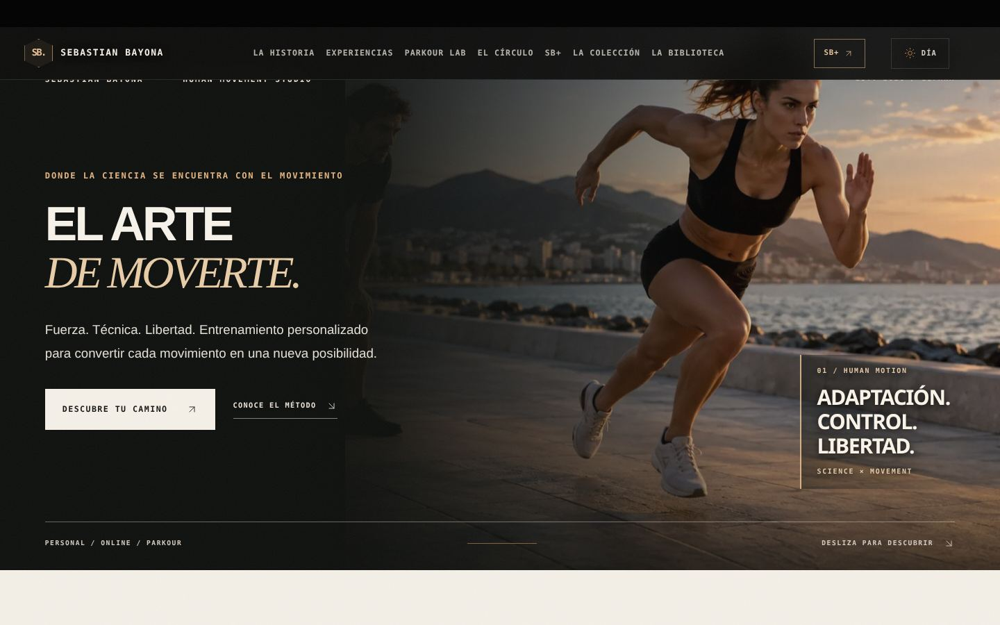
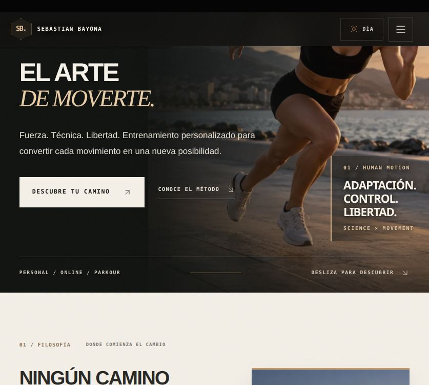
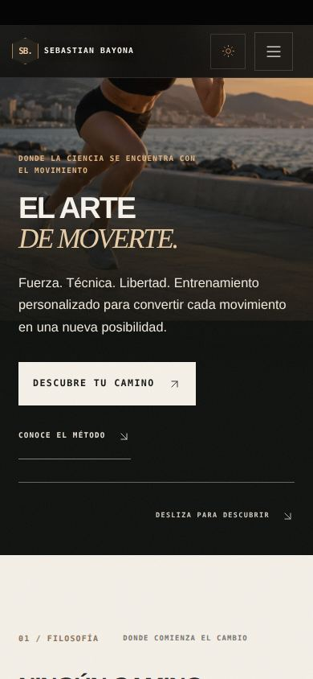
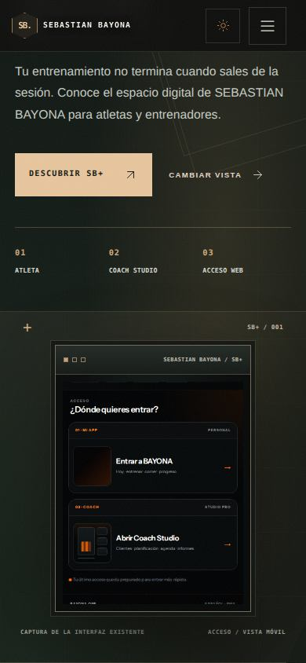
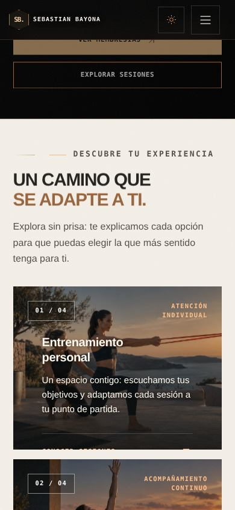
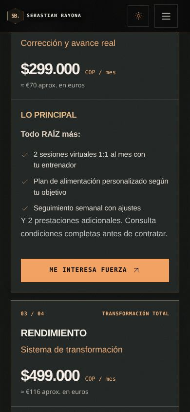

# SEBASTIAN BAYONA — Auditoría visual y SB+ Flagship
**3 de noviembre de 2026 · Trabajo de revisión sobre `2d766c1`**

**Resultado automatizado:** 28 de 28 pruebas Playwright aprobadas (navegación global, SB+, versiones responsive, contraste, recursos, multimedia y rutas). Compilación Vite aprobada; se mantiene la advertencia previa de tamaño para `vendor-three`.

## Objetivo
Sustituir la sección de SB+ que parecía un bloque de texto y una captura inclinada, retirar las capas invasivas «MISIÓN EN CURSO» y corregir defectos visuales observados en Experiencias. Mantener el contenido auténtico, la navegación, las rutas, la autenticación y el funcionamiento comercial sin prometer prestaciones que no estén demostradas.

## Cambios implementados
### SB+ / Presentación Flagship
- Nueva sección autónoma `SBFlagship.jsx` y `SBFlagship.css`, sustituyendo la sección anterior sin cambiar el ancla pública `#bayona-plus`.
- Tipografía editorial con combinación sans/serif, retícula técnica muy sutil, fondo de profundidad en verde carbón, acento bronce, marco de producto y estados accesibles.
- Una sola llamada de acción principal, **Descubrir SB+**, lleva a la ruta real `/app`.
- Selector funcional de dos vistas: **escritorio** y **móvil**, basado exclusivamente en dos capturas reales existentes del selector de perfiles. La vista móvil se muestra por defecto en pantallas de 600 px o menos.
- Etiquetas de producto: Atleta, Coach Studio y Acceso web; no se inventan métricas ni funciones supuestamente desplegadas.
- Ajustes responsive comprobados a 320, 390, 837 y 1440 px, también con preferencia por movimiento reducido.

### Limpieza transversal
- Retirados del recorrido editorial los HUDs de misión, los avisos de «NUEVO CAPÍTULO», las capas de animación ambiental, los paneles gamificados y los efectos invasivos vinculados a `showGuidedChrome`. Las páginas del sistema conservan sus componentes propios.
- Retirado del recorrido editorial el cursor personalizado y el indicador de progreso de lectura que interferían con la dirección visual.
- El pie de página, la navegación principal, las secciones de contacto reales y las rutas de productos permanecen disponibles.

### Experiencias / contraste
Se encontraron y corrigieron defectos concretos de legibilidad: párrafos casi blancos sobre fondo marfil en la introducción a las experiencias, énfasis naranja pálido sobre papel y nombres/titulares negros en tarjetas oscuras de planes. Los nuevos colores son de tinta gris profunda, bronce oscuro o marfil, según la superficie. También se mejora el tratamiento de imágenes y la separación de las tarjetas.

## Auditoría de nueve rutas
Se recorrieron en navegador automatizado, en pantalla móvil de 390 px: `/`, `/about`, `/programs`, `/parkour-academy`, `/community`, `/app`, `/shop`, `/resources` y `/faq`.

**Resultado de la inspección automática:**
- Ningún error JavaScript de página reportado durante la inspección.
- Ninguna imagen completada con anchura natural igual a cero tras navegar por las secciones.
- Ningún desbordamiento horizontal del documento a 390 px.
- Ningún enlace de ancla local sin destino encontrado en la inspección.
- Con las capas deshabilitadas, el único elemento fijo grande en la inspección fue el encabezado de navegación.

**Límites de la auditoría:** la ausencia de imágenes rotas no certifica permisos de imagen ni la calidad editorial de todas las fotos. La disponibilidad física de inventario, el estado operativo de los pagos, la publicación de la app y los consentimientos de imagen requieren comprobaciones independientes.

## Calidad y próximos elementos por resolver
- Verificación de compilación Vite y pruebas Playwright del rediseño SB+ junto con la regresión previa.
- Los recursos y el archivo de vídeos originales siguen utilizando sus rutas y lógica de reproducción.
- La captura real existente del acceso digital conserva la antigua rotulación interna «BAYONA». Para una coherencia total **hay que actualizar la interfaz real de la aplicación y volver a capturar su pantalla**, no retocar una captura para fingir ese cambio.
- El bundle compartido `vendor-three` mantiene una advertencia de tamaño. Una futura pasada de rendimiento debería dividir o cargar bajo demanda esa parte del código.
- Los precios visibles en la tienda/servicios siguen siendo los del proyecto y no se han modificado sin revisión comercial; Stripe debe comprobarse antes de recibir pagos.

## Capturas de verificación

## Ramas y publicación
Se trabaja en la rama aislada `feature/sebastian-bayona-flagship-qa-20261103`. La dirección de previsualización pública de tu ordenador seguirá siendo `http://127.0.0.1:4292/` cuando esta revisión sustituya la anterior. **No equivale a un despliegue en internet.**
