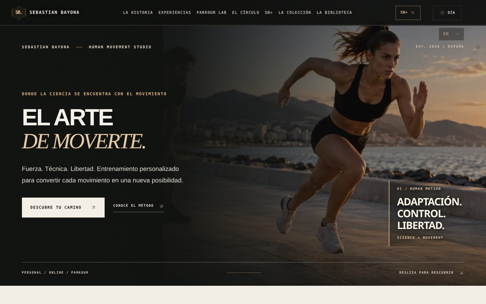
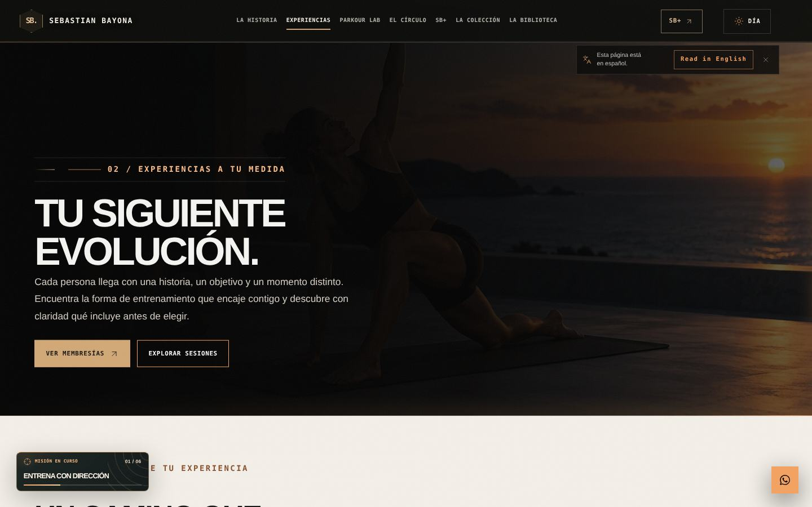
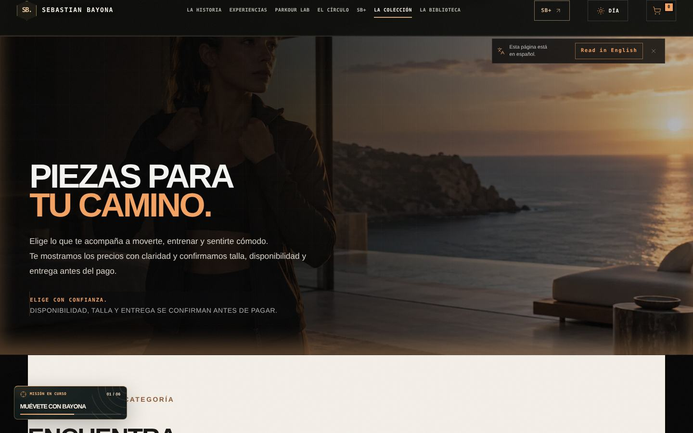
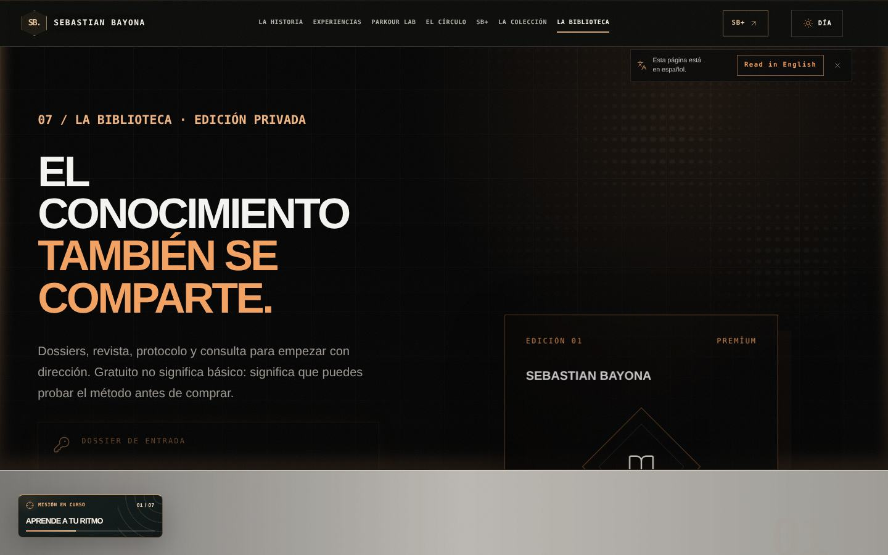
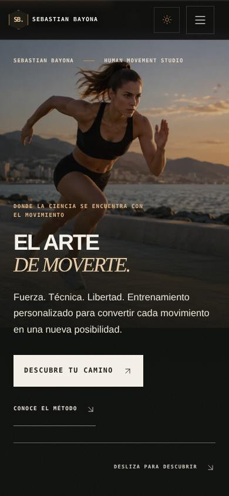

# SEBASTIAN BAYONA — Personal Movement Studio
**Rediseño de identidad y navegación global · 3 noviembre de 2026**

## Alcance comprobado
Rama aislada `feature/sebastian-bayona-full-site-20261103`. Base: `2bd674b` de la versión Luxury Studio. Se conservan el árbol de trabajo anterior y los cambios no comprometidos del otro proyecto, incluida su hoja de Stripe de pruebas.

**Nombre visible confirmado:** `SEBASTIAN BAYONA` (escrito exactamente como lo pidió el propietario). El monograma del encabezado es `SB.`. Se evita atribuirle al usuario rostros de personas no verificados.

| Ruta canónica mantenida | Nuevo nombre | Cambio principal |
|---|---|---|
| `/` | Inicio / SEBASTIAN BAYONA | Titular y firma personal |
| `/about` | La Historia | Origen personal, portadilla y filosofía |
| `/programs` | Experiencias | Portadilla y opciones de entrenamiento |
| `/parkour-academy` | Parkour Lab | Lenguaje editorial de movimiento y control |
| `/community` | El Círculo | Mensaje de comunidad y pertenencia |
| `/app` | SB+ | Interfaz pública del ecosistema digital |
| `/shop` | La Colección | Presentación editorial de artículos y catálogo existente |
| `/resources` | La Biblioteca | Guías, publicaciones y material de valor |
| `/faq` | Respuestas | Diseño coherente y título de acceso |

## Cambios transversales
- Marca global, monograma y pie de página alineados con el nombre personal, incluido el comportamiento de nombres extensos en móvil.
- Menú y pie de página con denominaciones editoriales de cada destino.
- Meta title y Open Graph, manifest y datos estructurados actualizados; se omite `legalName` hasta verificar entidad legal real.
- Capa visual global: negro carbón, marfil cálido, acentos dorados, tipografía editorial y navegación legible, con focos de accesibilidad.
- Héroes, títulos, tarjetas y botones de las rutas públicas unificados en la misma dirección visual.
- Fuera la cortina animada y el cargador bloqueante para rutas públicas. Los componentes siguen disponibles para páginas del sistema.
- Pie de página sin scroll horizontal a 320, 360, 390, 768 y 1440 px.
- Rutas, fuentes de fotos, flujos de carrito, contenido y acceso a la app se mantienen.

## Estado operativo y límites
- **Previsualización actual:** `http://127.0.0.1:4292/` — servidor local del ordenador; se sustituyó la previsualización anterior sin cambiar el puerto.
- **No se ha desplegado a producción.**
- Los nombres técnicos y enlaces internos de la app y los productos físicos siguen usando identificadores antiguos para preservar autenticación, SKU y rutas. Su migración requiere revisión por separado; los usuarios ya ven la marca personal en la web pública.
- Stripe continúa pendiente de verificación de la cuenta y del flujo de pagos reales. No se declara ningún pago ni stock confirmados.
- Fotografías editoriales generadas son imágenes conceptuales; no se presentan como fotografías del fundador. Los clips originales conservan las restricciones de revisión de derechos y privacidad.
- Los títulos y nombres se han cambiado globalmente, pero no se afirma que todas las capacidades internas de la app hayan sido renombradas ni que la tienda esté lista para recibir cobros reales.

## Calidad y pruebas
- Compilación Vite aprobada con el aviso existente sobre `vendor-three` (909 kB).
- Playwright comprueba 9 rutas públicas, sus metadatos y nombre, menús móviles, carrito, recursos descargables y vídeo bajo demanda.
- Pruebas responsive: 320, 360, 390, 768, 1440 px.
- No se modifica la hoja `src/styles/stripe-sandbox.css` no comprometida en el árbol Luxury Studio original.

## Capturas

## Próxima fase comercial
Verificar catálogo disponible, proveedores, moneda y países de envío; activar pagos verificados en Stripe; conectar leads consentidos y medición de embudo desde campañas. No publicar ofertas de stock o testimonios no corroborados.
