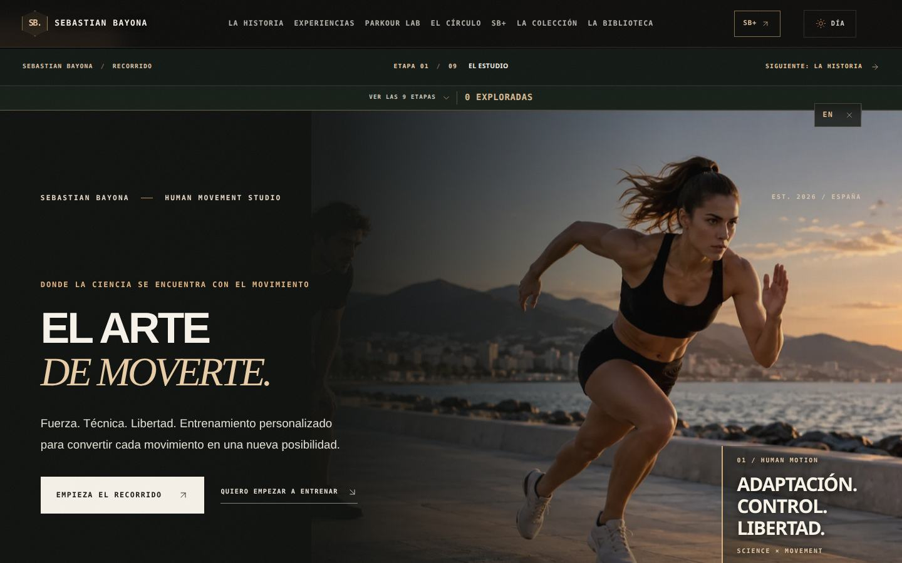
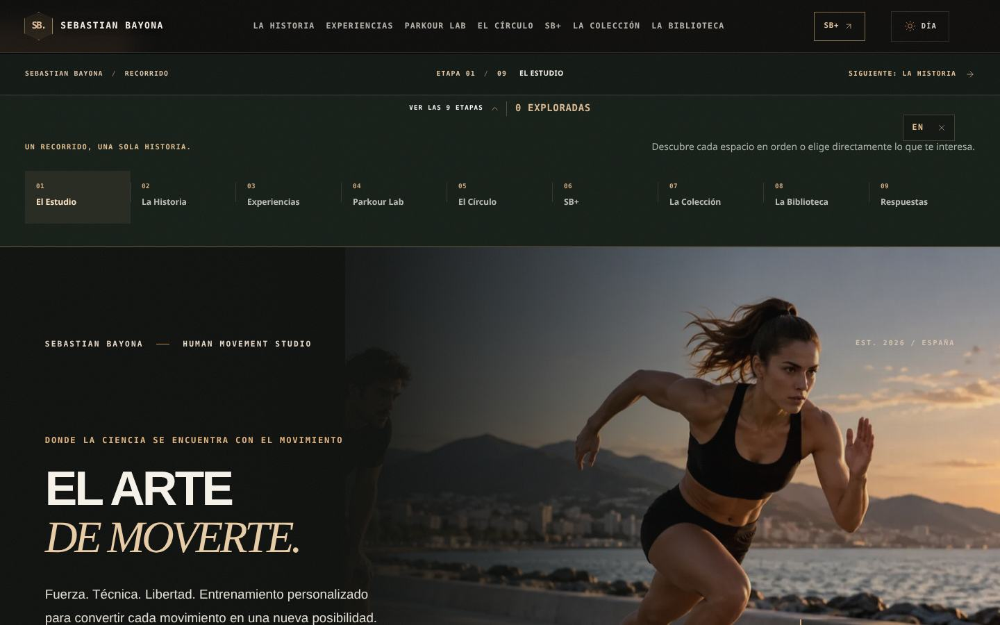
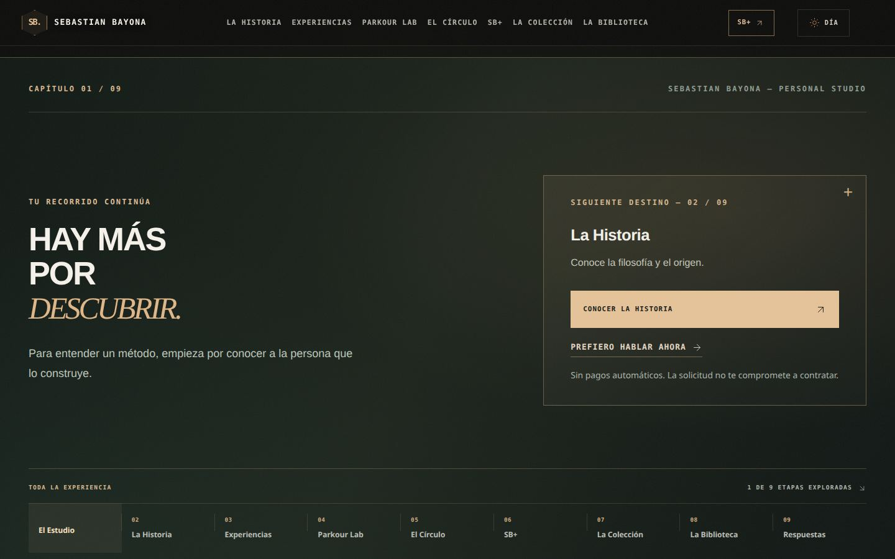
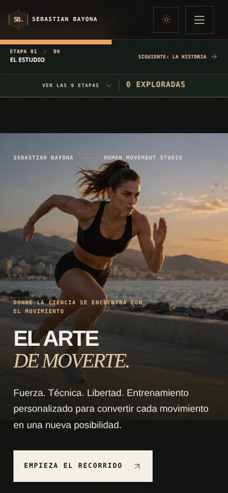
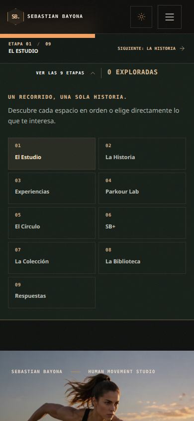
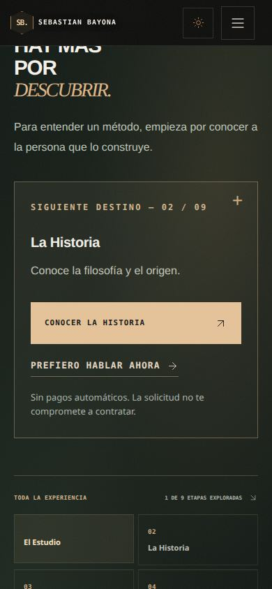

# SEBASTIAN BAYONA — Recorrido guiado editorial
**4 de noviembre de 2026 · Rama `feature/sebastian-bayona-guided-journey-20261104`**

## Problema corregido
La web ya tenía las nueve páginas con una identidad común, pero no explicaba al usuario cómo recorrerlas ni cuál era la acción siguiente. Quien entraba en una página interior podía leerla sin comprender su relación con las demás. La sección de cierre no proponía un siguiente destino, y en la Home el CTA solo desplazaba a otra sección de la misma página.

## Solución entregada
1. **Barra editorial debajo de la navegación fija** con la etapa actual, una propuesta de siguiente página y un mapa desplegable de los nueve capítulos. Compatible con teclado y lector de pantalla.
2. **Secuencia de nueve capítulos**, con relato contextual entre páginas: Inicio → La Historia → Experiencias → Parkour Lab → El Círculo → SB+ → La Colección → La Biblioteca → Respuestas.
3. **Cierre editorial único en cada página**: explica por qué continuar, incluye CTA real a la siguiente página y permite hablar por WhatsApp en cualquier momento.
4. **Desenlace de conversión** en Respuestas: CTA al configurador `/checkout`, que prepara una solicitud sin cobro automático ni activación de membresía.
5. **Progreso persistente y veraz** en `localStorage` (`sb:studio-journey:v1`) que solo marca una etapa como explorada cuando el visitante realmente alcanza su cierre. No se inventan ventas, registros ni estadísticas de usuario.
6. **Control y libertad**: todas las páginas pueden abrirse en cualquier orden, no hay puertas bloqueadas, popups, overlays de misión ni navegación forzada.
7. **CTAs Home actualizados**: «Empieza el recorrido» conduce a `/about`, «Quiero empezar a entrenar» lleva al contacto real `/#empieza`.
8. **Instrumentación** con eventos `studio_journey_start`, `studio_journey_continue`, `studio_journey_chapter_read` y `studio_journey_contact`, sin atribuir compras a simples clics.

## Estructura y pruebas
- Componente principal: `src/components/journey/StudioJourney.jsx`.
- Estilos aislados: `src/components/journey/guided-journey.css`.
- Integración central: `src/App.jsx`, sobre todas las páginas editoriales; excluye panel, checkout, confirmación y 404.
- Suite específica: `e2e/studio-journey.spec.js` — **10/10 pruebas aprobadas**: nueve enlaces, CTA home, progreso persistente, mapa móvil, conversión final y navegación responsive a 320, 390, 837 y 1440 px.
- Inspección manual automatizada de nueve rutas en escritorio y móvil: todas devuelven HTTP 200; no hubo errores JavaScript de página ni desplazamiento horizontal.
- No se han cambiado tarifas, SKU, credenciales, inventario ni roles de entrenador.

## Métricas a revisar antes y después de lanzar
- Porcentaje de sesiones que abren el mapa de etapas.
- Proporción de visitantes que llegan al cierre de cada página.
- Transiciones a las etapas siguientes.
- Visitas al configurador de solicitud, clics legítimos de WhatsApp y solicitudes recibidas; **no equivalen automáticamente a ventas**.
- Conversión real tras la verificación del pago y confirmación del servicio, si finalmente se activa Stripe en modo live.

## Limitaciones
Esta entrega mejora el flujo de descubrimiento y facilita la acción. No implica que todas las personas vayan a completar obligatoriamente las nueve páginas: forzar la lectura perjudicaría la experiencia y la accesibilidad. El aumento de conversiones necesita medición con tráfico real. La cuenta Stripe conectada sigue siendo de pruebas; no se han activado pagos ni desplegado cambios al dominio público.

## Capturas

## Regresión final
- **28/28 pruebas** del diseño previo y las rutas públicas aprobadas: sección SB+, tipografía y contraste de Experiencias, rutas del menú, galería de vídeos, descargas y tienda sin activación de cobros.
- **10/10 pruebas** del itinerario guiado aprobadas.
- **Compilación de producción y auditorías poscompilación aprobadas**: sin enlaces Stripe de prueba en el bundle público; carga inicial estática 227 KiB gzip y motor 3D diferido.
- Total del ciclo del recorrido: **38/38 comprobaciones E2E aprobadas**.
