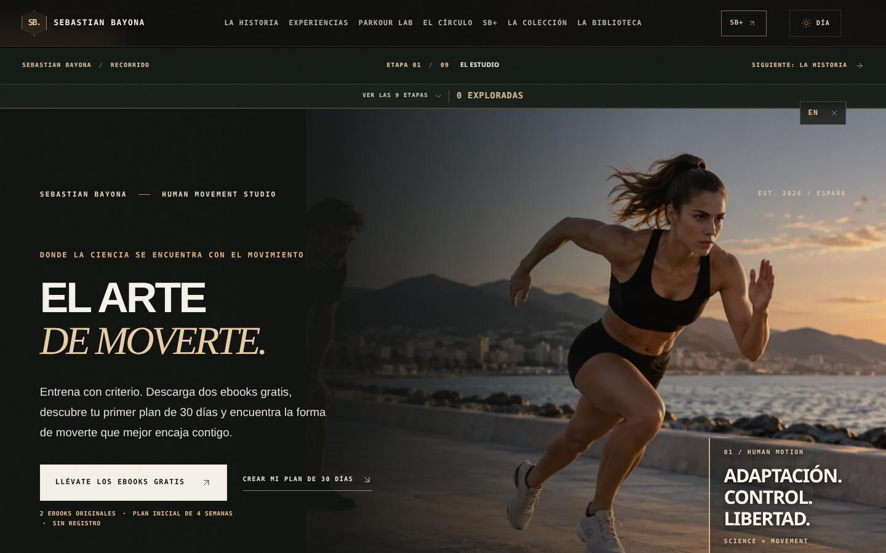
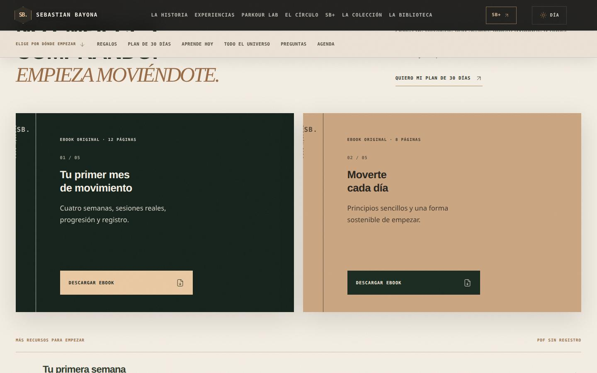
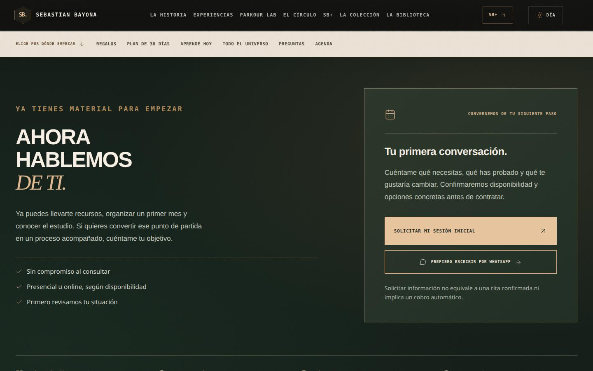
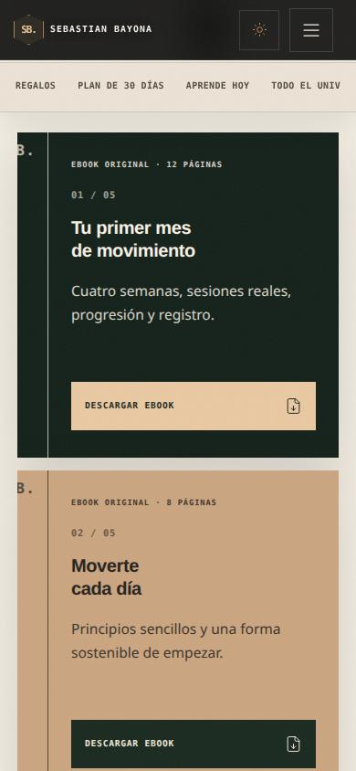
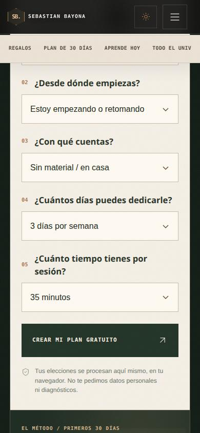
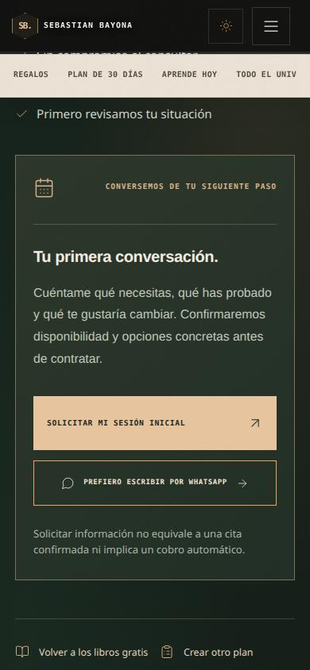

# SEBASTIAN BAYONA — Landing de valor primero
**Auditoría multidisciplinar e implementación · 4 de noviembre de 2026**

## Dirección de marketing

La portada ya no pide al visitante que compre o visite nueve páginas antes de recibir valor. Primero entrega material original, una propuesta de práctica y un pequeño configurador educativo. Después permite conocer las secciones de la marca y facilita una conversación de valoración.

### Las secciones de la nueva portada

1. Hero de entrada: dos ebooks gratis y plan inicial de cuatro semanas.
2. Índice de seis destinos: Regalos, Plan, Lecciones, Universo, Preguntas y Agenda.
3. Biblioteca gratuita: dos nuevos ebooks originales y tres documentos anteriores; sin registro ni solicitud de correo electrónico.
4. Plan de 30 días: cuestionario de cinco elecciones — objetivo, nivel, equipo, frecuencia y duración — que genera cuatro semanas, permite guardar e imprimir y presenta revisión opcional.
5. Tres lecciones con ejercicios y principios comprensibles.
6. Manifiesto, experiencias y método de entrenamiento.
7. Archivo documental de vídeos auténticos existente.
8. Presentación SB+ con capturas reales y acceso.
9. Capítulos visuales dedicados a Historia, Experiencias, Parkour Lab, Movimiento adaptado, Círculo, SB+, Colección y Biblioteca.
10. Preguntas frecuentes con respuestas claras.
11. Conversación final con solicitud de cita o WhatsApp, sin fingir confirmación ni pago.

Además, la navegación global permanece y enlaza las rutas de las nueve páginas interiores.

## Comité multidisciplinar: seis perspectivas de revisión

Esto es un análisis por perspectivas profesionales, no una reunión real de asesores externos contratados.

| Perspectiva | Problema original | Solución implementada |
|---|---|---|
| Marketing de conversión | El visitante tenía que navegar sin recibir nada útil | Dos ebooks originales y configurador sin registro desde el inicio |
| Experiencia y arquitectura | Escaparate largo sin recorrido y sin atajos | Índice, capítulos conectados y final claro |
| Redacción y lectura | Imágenes y titulares sin suficiente instrucción | Textos breves, títulos útiles, ejemplos y bloques editoriales |
| Ciencias del ejercicio | “Personalizada” podía sugerir valoración clínica | Borrador educativo por elecciones y revisión opcional |
| Comercio responsable | Stripe solo en pruebas y sin stock verificado | Consulta sin pagos automáticos ni plazas ficticias |
| Ingeniería/accesibilidad | Carga y recorrido móvil complicados | Imágenes lazy, selects nativos, tabuladores accesibles, printable |

## Evidencia que apoya las decisiones

- Nielsen Norman Group explica el escaneo de páginas mediante capas de encabezados: https://www.nngroup.com/articles/layer-cake-pattern-scanning/
- Nielsen Norman Group describe cuándo usar acceso directo frente a navegación secuencial: https://www.nngroup.com/articles/direct-vs-sequential-access/
- Unbounce ofrece benchmarks por industria y canal, sin garantía de conversión para un sitio concreto: https://unbounce.com/conversion-benchmark-report/
- Baymard documenta el coste de obligar a registrarse antes de comprar: https://baymard.com/blog/checkout-flow-ux-optimization
- ACSM, actualización 2026, apoya el entrenamiento de resistencia flexible y progresivo: https://pmc.ncbi.nlm.nih.gov/articles/PMC12965823/

No se presentan estadísticas de negocio de esta landing como si ya hubiera conversiones registradas.

## Recursos reales creados

- public/downloads/sebastian-bayona/tu-primer-mes-de-movimiento.pdf — ebook PDF A4 de 12 páginas, 4 semanas y hojas de registro.
- public/downloads/sebastian-bayona/moverte-cada-dia.pdf — ebook PDF A4 de 8 páginas, hábitos y movilidad diaria.
- docs/books/tu-primer-mes-de-movimiento.md — texto fuente editable.
- docs/books/moverte-cada-dia.md — texto fuente editable.
- scripts/build-free-motion-books.mjs — generación reproducible con Pandoc y Playwright y detección de contenido recortado.
- scripts/book-motion-pdf.css — estilo editorial de impresión, marfil/verde/cobre.

Los dos libros son nuevos; los otros tres PDF ya estaban disponibles antes de esta revisión.

## Conversión legítima: qué medir

Visita y clic de entrada → descarga real de libro → borrador creado → visita a un área de la web → clic a consulta → mensaje de calidad recibido → cita confirmada → contratación realmente verificada.

**No contar una visita, un clic en WhatsApp ni un borrador generado como ventas**. La analítica existente solo inicia proveedores externos tras el consentimiento apropiado.

## Hipótesis de experimentación después de lanzar

- Orden del CTA principal: ebook primero frente a plan primero.
- Longitud de la portada: lectura extensa frente a acceso rápido a capítulos (ambas mantienen el contenido).
- Texto de conversión final: “Solicitar mi sesión inicial” frente a “Hablar de mi objetivo”.

Validarlas solo con tráfico suficiente y teniendo en cuenta la calidad de los contactos, no métricas de vanidad.

## Alcance y límites

El configurador aplica reglas transparentes de entrenamiento general a las cinco elecciones; es un borrador educativo y no una prescripción médica ni un plan individual supervisado. No recibe datos sanitarios ni fuerza el registro. En casos de lesión, dolor o condiciones médicas relevantes, se recomienda valoración adecuada.

Los productos, precios, inventario, roles, logins y pagos reales no se han modificado. Stripe continúa en modo de prueba. La nueva rama se despliega solo en el ordenador, en previsualización local; no se modifica el dominio público.

## Capturas

## Verificación técnica final

- **11/11 pruebas** específicas de la nueva landing aprobadas. Verifican los cinco recursos PDF, diferencias de rutinas entre parkour principiante y fuerza en gimnasio, cuatro semanas, descarga del plan, impresión, FAQ, enlaces a toda la web, index y pantallas de 320/360/390/768/1440 px.
- **37/38 pruebas** de regresión aprobadas en la primera ejecución. La única incompatibilidad era un selector del antiguo bloque de contacto; se restauró el contenedor y la prueba fallida volvió a pasar por separado (**1/1**). El resto de las pruebas de regresión pasan sin cambio.
- **Compilación final aprobada**, incluidas auditoría Stripe y auditoría de carga inicial. Bundle de entrada: 238 KiB gzip, el motor Three.js continúa diferido (aviso de 909 KiB del chunk 3D).
- PDF **12 + 8 páginas A4**: ambos generados desde Markdown, verificados mediante representación de páginas, texto extraído y control de desbordamientos en cada página.
- La auditoría visual de la landing a 320, 390, 837 y 1440 px no encontró errores JavaScript, imágenes rotas ni desplazamiento horizontal; ambos ebooks y el plan caben en móvil. Capturas verificadas en la carpeta de recursos.

### Nota sobre el resultado comercial
No se han medido conversiones reales ni reservado automáticamente citas; la llamada final abre la agenda solo si está configurada y, de lo contrario, WhatsApp para consultar disponibilidad. Ningún enlace realiza cobros reales.
