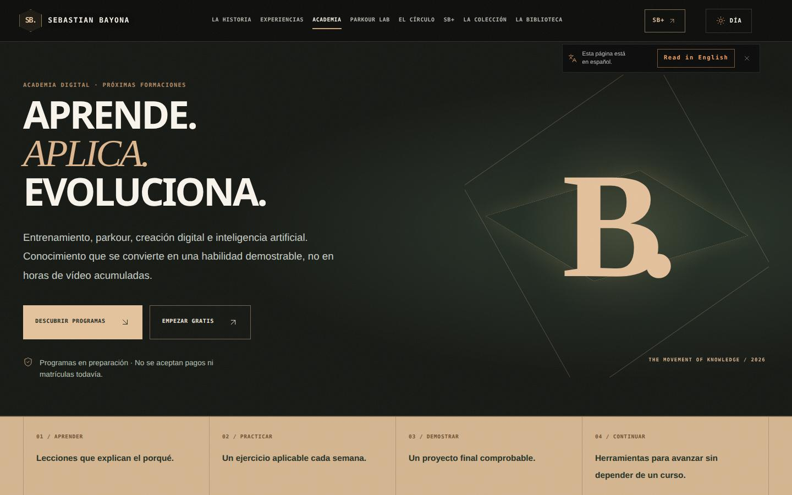
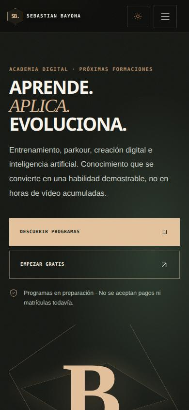
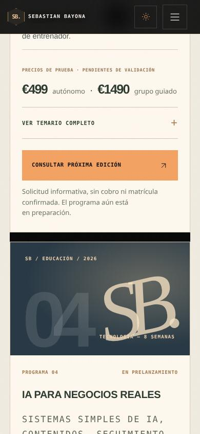
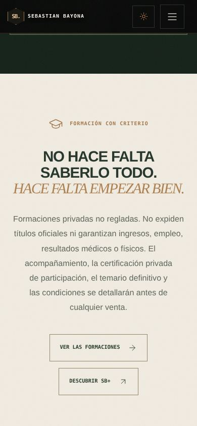

# ACADEMIA SEBASTIAN BAYONA — PLAN MAESTRO
**Versión 1.0 · 6 de noviembre de 2026 · Documento de desarrollo**

> Estado: seis programas diseñados y en prelan­zamiento. No hay matrículas, ventas, vídeos grabados ni plazas confirmadas que deban comunicarse como existentes. Los precios son hipótesis de test.

## 1. Tesis comercial

No vender cursos genéricos sobre todo. Convertir experiencia demostrable en tres tipos de progreso:

- **Movimiento:** fuerza, movilidad, planificación y parkour básico a ras del suelo.
- **Práctica profesional:** organización de clientes, planificación, seguimiento y experiencia digital de los entrenadores.
- **Negocio y creación:** diseño de ofertas, contenido útil y automatizaciones de IA revisadas por humanos.

La historia de adaptación y emprendimiento refuerza la identidad, pero no habilita automáticamente a dar terapia, asesoramiento médico, jurídico, fiscal o titulaciones oficiales.

## 2. Catálogo

| Programa | Duración | Público | Precio de test autónomo | Precio de test acompañado |
|:--|--:|:--|--:|--:|
| Movimiento 360° | 12 semanas | Adultos activos | 149 € | 449 € |
| Parkour Lab · Bases | 8 semanas | Iniciación supervisable | 129 € | 349 € |
| Coach Studio IA | 10 semanas | Entrenadores y estudios | 499 € | 1.490 € |
| IA para Negocios Reales | 8 semanas | Autónomos y microempresas | 299 € | 990 € |
| Marca en Movimiento | 6 semanas | Creadores y profesionales | 179 € | 490 € |
| Disciplina y Adaptación | 6 semanas | Personas que buscan hábitos | 79 € | 249 € |

Cada módulo utiliza el sistema **pregunta → explicación → ejercicio práctico → evaluación**. Cada programa culmina en un proyecto demostrado, no una acumulación de vídeos. El contenido final de pago se producirá y verificará antes de admitir matrículas.

## 3. Prioridades

**A. Coach Studio IA:** alto valor por alumno profesional. Entrevistar a diez entrenadores que ya administren clientes y realizar un taller piloto de diagnóstico de procesos. Enseñar sistemas que pueden adoptar sin depender de una app concreta y sin subir datos privados a modelos externos.

**B. Movimiento 360°:** producto principal B2C alimentado por el ebook gratuito y el plan orientativo de 30 días. Una clase abierta muestra técnica, seguridad y cómo construir una semana realista.

**C. Parkour Lab:** especialidad con autoridad personal y enfoque de progresión. Iniciar con equilibrio, coordinación, apoyos y desplazamiento a ras de suelo; técnicas de altura solo en contexto supervisado.

Los otros tres cursos se lanzarán tras comprobar resultados de aprendizaje y demanda.

## 4. Diseño de la experiencia formativa

Cada lección debe contener: objetivos observables, 10–20 minutos de explicación prevista, demostración propia cuando se grabe, un ejercicio práctico, preguntas de autoevaluación, errores frecuentes, una rúbrica de criterios y un siguiente paso.

**Autoguiado:** materiales originales y correcciones mediante rúbricas claras; no prometer tutoría individual.

**Grupo acompañado:** plazas, soporte y horarios publicados antes de cobrar; revisión humana de trabajos. No anunciar sesiones en vivo aún no programadas.

**B2B:** diagnóstico + formación + plantilla + implantación + transferencia documentada; precio individual según equipo, duración y derechos de uso.

**SB+:** únicamente mostrar programas y materiales; acceso de pago a contenido privado solo después de una autorización validada en servidor.

## 5. Embudo de valor y comercio

Entrada con vídeos educativos y ebooks originales gratuitos → clase abierta útil → lista de interés voluntaria → descripción verificable del programa → contrato y pago cuando esté realmente preparado → entrega en SB+ o LMS → evaluación → testimonios solo con consentimiento.

Shopify, cuando se conecte, gestiona catálogo, checkout y pedidos; SB+ gestiona aprendizaje. Una compra verificada y un webhook auténtico deben conceder permisos por usuario. Jamás desbloquear cursos mediante un parámetro de URL o un valor manipulable en localStorage.

**Antes de cobrar:** verificar la situación para ejercer actividad económica, fiscalidad, documentos de venta, privacidad, condiciones de acceso, normativa de protección de consumidores y desistimiento aplicable. La academia es privada y no reglada: no debe anunciar títulos oficiales ni habilitaciones inexistentes. No revender vídeos de terceros, como bibliotecas de ejercicios ajenas, sin licencia comercial adecuada.

## 6. Escenario de escala, NO pronóstico

Un escenario matemático para ilustrar qué significa superar un millón de euros de **facturación bruta**, sin estimar probabilidades:

| Línea de negocio | Unidades hipotéticas | Precio supuesto | Importe |
|:--|--:|--:|--:|
| Movimiento 360° autoguiado | 2.500 | 149 € | 372.500 € |
| Coach Studio IA autónomo | 400 | 499 € | 199.600 € |
| Coach Studio IA acompañado | 120 | 1.490 € | 178.800 € |
| Licencias e implementaciones B2B | 40 | 6.500 € | 260.000 € |
| **Total hipotético** | | | **1.010.900 € brutos** |

**No es dinero ganado, beneficio neto, proyección fiable ni resultado garantizado.** Requeriría miles de compradores, equipo, soporte y una distribución comercial probada. Los 6.500 € de B2B son una hipótesis, no tarifa ofertada. Deben descontarse impuestos, devoluciones, marketing, captación, pasarelas, software, grabación, nóminas, licencias y demás costes.

## 7. Implementación de 90 días

**Días 1–14:** tres primeras clases completas y página de catálogo. Entrevistas de demanda con entrenadores y potenciales alumnos. Identificar problema real y disposición a pagar.

**Días 15–30:** clases gratuitas pequeñas, tareas de prueba, feedback cualitativo y solo captación de contactos con consentimiento.

**Días 31–45:** producir M1–M3 de un curso prioritario; grabaciones propias, hojas de ejercicios, rúbrica, LMS y texto legal revisados.

**Días 46–60:** edición piloto con contenido y condiciones verificadas; ningún cobro de cursos no entregables.

**Días 61–75:** acompañamiento y mejoras según dificultades reales, seguimiento de reembolsos y culminación.

**Días 76–90:** decidir con datos si vale la pena ampliar contenidos, anunciar, automatizar y licenciar.

## 8. Indicadores

Visitas → descarga real → interés opt-in → conversación cualificada → matrícula confirmada → actividad del alumno → entregable evaluado → finalización → devolución/satisfacción → ingresos netos. Un clic en WhatsApp no es una compra, ni ver un vídeo equivale a aprender.

## 9. Materiales creados en esta rama

- Catálogo de seis currículos en src/config/academyCourses.js.
- Landing editorial en src/pages/Academy.jsx.
- Estilo responsive en src/styles/academy.css.
- Ruta /academia y enlace en navegación, tienda y PWA SB+.
- Primeras lecciones escritas de Coach Studio IA, Movimiento 360° y Parkour Lab.

**Pendiente:** revisar y probar la rama, conectar Shopify, grabar contenidos propios, validar la viabilidad económica y publicar condiciones antes de cobrar. No existe una matrícula real activa.

## 10. Fuentes

- ACSM 2027 Worldwide Fitness Trends: https://doi.org/10.1249/FIT.0000000000001208
- World Economic Forum, Future of Jobs 2025: https://www.weforum.org/publications/the-future-of-jobs-report-2025/
- Comunidad de Madrid, formación no reglada y derechos: https://www.comunidad.madrid/consumo/recomendaciones-tener-cuenta-antes-contratar-curso-formacion-online-no-reglada
- Ministerio de Consumo, regulación por comunidades autónomas: https://www.dsca.gob.es/es/consumo/preguntas-frecuentes/que-administracion-es-competente-regular-ensenanza-no-reglada

## 11. Estado de desarrollo y pruebas verificadas

- Catálogo, seis temarios, página pública, acceso desde tienda y SB+ PWA implementados en rama de desarrollo.
- Guiones completos de las primeras clases de Coach Studio IA, Movimiento 360° y Parkour Lab redactados y guardados en este repositorio.
- Compilación Vite de producción finalizada correctamente; controles de enlaces Stripe de pruebas y carga inicial aprobados.
- **9/9 pruebas E2E de la academia aprobadas**: rutas, filtros, temario, app, responsividad a 320/390/768/1440 píxeles, SEO y contraste.
- **10/10 pruebas E2E del recorrido editorial anterior aprobadas** en la regresión conjunta.
- Corrección aplicada a reglas de CSS heredadas que reducían el contraste del cierre editorial y cambiaban los CTA de la academia.
- Canonical único gestionado por ruta desde RouteSeo; el canonical estático anterior duplicaba la etiqueta en las páginas de la SPA.
- Se conserva la versión anterior de la web en el servidor local de previsualización 4292; la Academia funciona en la previsualización aislada 4311.

### Capturas de revisión

**Pendiente antes de aceptar dinero:** completar producción real del contenido anunciado, definir entregas/soporte/fechas, comprobar obligaciones legales y conectar una tienda Shopify autorizada. No existe activación de cobros, acceso LMS basado en compra ni matrícula confirmada.
